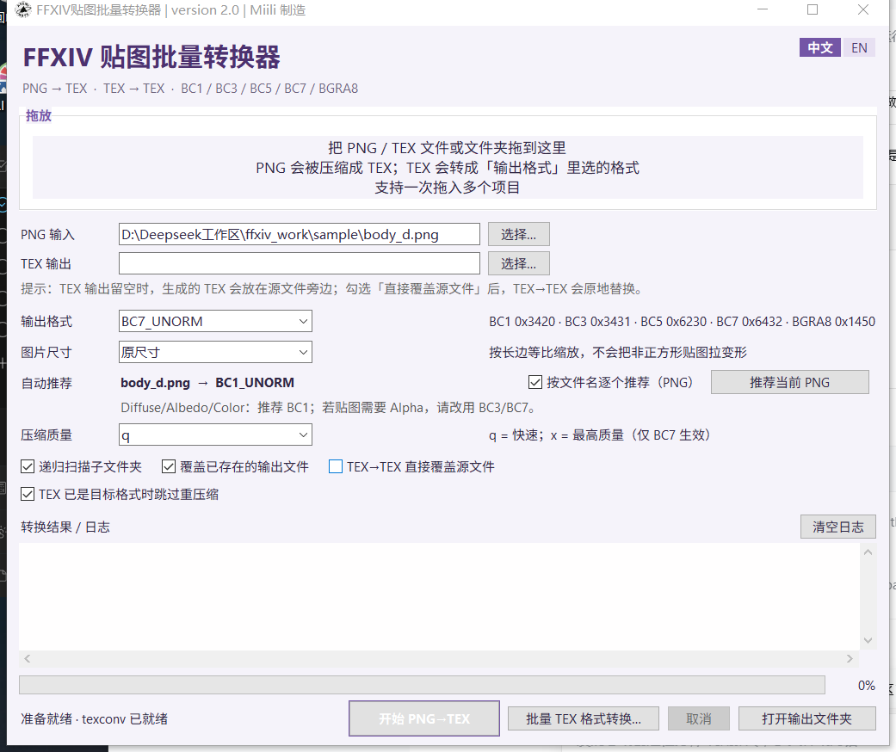
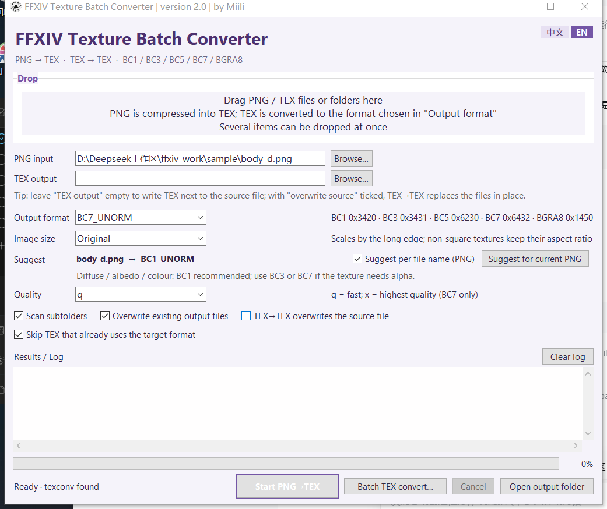

# FFXIV Texture Batch Converter

**Batch PNG → TEX and TEX → TEX conversion for FINAL FANTASY XIV, in one window.**
把 PNG 批量压成 FFXIV TEX，也能把已有 TEX 换成别的压缩格式。

[](README.txt)
[](#requirements)
[](#language--语言)
[](#license)

A standalone Windows desktop tool — **no Dalamud, no game injection, no plugin loader**. It reads and writes FFXIV `.tex` containers directly and calls Microsoft's `texconv` for the actual BC compression.

| 中文 | English |
|:---:|:---:|
|  |  |

---

## Features

- **One drop, mixed input.** Drag PNG **and** TEX files/folders in at the same time; each is routed by its own rules.
- **Auto format suggestion.** Reads the file name and picks a sensible target: `*_d` → BC1, `*_n` (normal) → BC7, `*_rg` → BC5, UI/atlas/effect → BC7, and so on — with the reason printed in the log.
- **Fast batching.** Up to 16 files per `texconv` process instead of one process per texture (~10× fewer process startups).
- **Long-edge resizing** that never distorts non-square textures (1024×512 stays 2:1) and snaps to multiples of 4 for BC blocks.
- **Cancel that actually cancels** — kills the running `texconv` immediately.
- **Progress with ETA**, per-file log with output size and compression ratio (colored by result).
- **Atomic writes** — every TEX is written to a temp file and renamed, so a crash or cancel never leaves a half-written texture.
- **No silent overwrites** — same-named files landing in one output folder get `_2`, `_3`, … suffixes.
- **Remembers everything** — options, window size/position and UI language live in `%APPDATA%\Miili\FFXIV贴图批量转换器\`.
- **Bilingual UI** — 中文 / English, one click, remembered.
- **Self-test and headless mode** — verify a build or script a batch without the GUI.

## Supported formats

| Target | TEX format ID | DXGI | Size | When to use |
|---|---|---|---|---|
| `BC1_UNORM` | `0x3420` | 71 | 8 B / 4×4 block | Opaque diffuse. Half the size of BC7. **No smooth alpha.** |
| `BC3_UNORM` | `0x3431` | 77 | 16 B / 4×4 block | Diffuse with soft transparency. |
| `BC5_UNORM` | `0x6230` | 83 | 16 B / 4×4 block | Genuinely two-channel data (RG maps). |
| `BC7_UNORM` | `0x6432` | 98 | 16 B / 4×4 block | Best quality for RGBA; the safe default. Slowest. |
| `B8G8R8A8_UNORM` | `0x1450` | 87 | 4 B / pixel | Uncompressed, lossless, largest. |

`texconv` is bundled, so nothing else needs to be installed. Full mip chains are always generated, because FFXIV expects them.

## Requirements

- Windows 10 / 11 (x64). The tool ships a Windows-only compressor.
- Nothing else — Python is only needed if you build from source.

## Install

1. Grab `FF14 Tex Converter.exe` from the [Releases](../../releases) page (or from `dist/` in the archive).
2. Put it anywhere and run it. It is a single file; no installer, no admin rights.

Settings and the error log are written to `%APPDATA%\Miili\FFXIV贴图批量转换器\`.

## Usage

### PNG → TEX

1. Drop PNG files/folders onto the window, or use **PNG input → Browse…**.
2. Pick an **Output format** (or leave **Suggest per file name** ticked).
3. **TEX output** empty = write next to the source file; pick a folder to mirror the subfolder structure.
4. Press **Start PNG→TEX**.

### TEX → TEX

Drop `.tex` files, or press **Batch TEX convert…**. The selected output format becomes the target. Output is `*_converted.tex` by default; tick **TEX→TEX overwrites the source file** to replace in place (it asks first). TEX already in the target format is skipped by default to avoid re-compression loss.

### 中文速览

拖入 PNG / TEX → 选「输出格式」（或勾「按文件名逐个推荐」）→ 点「开始 PNG→TEX」。`TEX 输出` 留空则生成在源文件旁边；勾选「TEX→TEX 直接覆盖源文件」会原地替换（有确认提示）。详情见仓库内 `README.txt`。

## Language / 语言

The **中文 | EN** chips in the top-right corner switch the whole interface — labels, log messages, error text, format suggestions and the status bar. The choice is written to the settings file (`"lang": "cn" | "en"`) immediately and restored on the next launch. Default is 中文. Delete the field to fall back to it.

## Command line

```bat
:: convert (same code path as the Start button)
"FF14 Tex Converter.exe" --convert <file-or-folder> [output-dir] [--format BC7_UNORM]

:: end-to-end self test; writes selftest_report.json and exits 0 on success
"FF14 Tex Converter.exe" --selftest [output-dir]
```

`--convert` writes `convert_report.json` into the output folder and returns `0` only if every file succeeded. Both modes follow the language saved in settings, so logs come out in the language you last used.

## Build from source

```bat
:: one click: checks Python, installs PyInstaller, fetches texconv, builds, renames
BUILD_EXE.bat

:: or manually
py -m pip install --upgrade pyinstaller
py prepare_texconv.py
py -m PyInstaller --noconfirm --clean FFXIVTextureBatchConverter.spec
py rename_output.py
```

Running the sources directly works too: `py main.py`. Requires Python 3.10+ with Tk.

## Project layout

```
main.py                            UI, drag & drop, settings, threading
texlib.py                          TEX/DDS read-write, texconv batching, format advice
i18n.py                            中文 / English strings (single source of truth)
FFXIVTextureBatchConverter.spec    PyInstaller build config
prepare_texconv.py                 fetch texconv.exe before packaging
rename_output.py                   post-build rename of the EXE
BUILD_EXE.bat / CLEAN_BUILD.bat    one-click build / clean
tools/texconv.exe                  Microsoft DirectXTex compressor
docs/                              screenshots
README.txt                         detailed changelog and notes (中文)
```

## Notes and known limits

- **BC1 has no smooth alpha.** Fully transparent pixels become black in game. The tool compresses BC1 as opaque and warns you; use BC3 or BC7 when you need transparency.
- Only FFXIV **2D** TEX is supported. Cube maps, texture arrays, 3D textures and formats such as BC4/BC6H are rejected with a clear error rather than guessed.
- Windows path limit: output paths over 250 characters are flagged in the log before they fail.
- BC7 with `x` quality is noticeably slower than `q`; use it for hero assets, not for thousands of icons.

## Credits & acknowledgements

This project stands on other people's work. The FFXIV TEX container layout, the format IDs above, the mip-chain layout and the BC1 alpha behaviour were all reverse-engineered and published by these projects first:

- **[TexTools](https://github.com/TexTools/FFXIV_TexTools_UI)** (GPL-3.0) — the TEX read/write logic in `texlib.py` is based on TexTools' implementation of the FFXIV texture container.
- **[Penumbra](https://github.com/xivdev/Penumbra)** (xivdev) — texture format IDs and the per-usage format conventions (which role maps to BC1/BC3/BC5/BC7) follow Penumbra's implementation.
- **[Microsoft DirectXTex](https://github.com/microsoft/DirectXTex)** (MIT) — `texconv.exe` does all the actual block compression; the bundled copy is unmodified.
- **Python** and **Tkinter** — runtime and GUI toolkit.

If you maintain one of these projects and want the wording or attribution changed, please open an issue — it will be fixed quickly.

## How this was built

The code was written with AI coding agents as the main implementers, under human direction and review:

- **[DeepSeek](https://www.deepseek.com/)** — architecture, TEX/DDS container logic, the Tk UI, the bilingual layer and the test harness.
- **OpenAI Codex** — refactoring, bug hunting and test automation.

审阅、需求与发布由 **Miili** 负责。

## License

**GPL-3.0.** This project builds on TexTools, which is licensed under the GNU General Public License v3.0, so the same license applies here: if you redistribute this tool or a modified version, you must make the complete corresponding source available under GPL-3.0.

`tools/texconv.exe` is Microsoft DirectXTex, distributed under the MIT license and included unmodified.

## Disclaimer

Unofficial fan tool. Not affiliated with, endorsed by, or supported by Square Enix, the TexTools team, the Penumbra team or Microsoft. FINAL FANTASY XIV is a trademark of Square Enix Holdings Co., Ltd. Use at your own risk and keep backups of any texture you overwrite.
